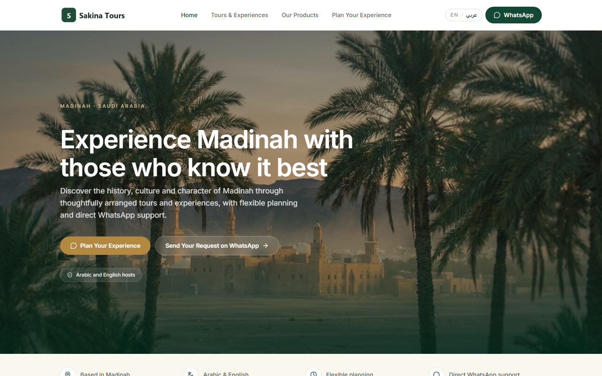
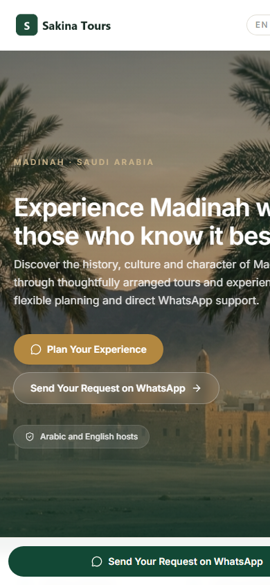

# Sakina Tours — Madinah Tours Website

Bilingual (English / Arabic) website for **Sakina Tours** (سكينة), a local tour and experience host in Madinah, Saudi Arabia. Visitors browse tours and local products, then plan a trip through a guided form that sends the request on WhatsApp.



<p align="center">
  
</p>

## Highlights

- **Two languages, twelve pages.** Six pages in English and Arabic, with full right-to-left mirroring. The switcher lands on the same page in the other language.
- **Type-safe translations.** The Arabic dictionary is typed against the English one, so a missing key is a build error.
- **WhatsApp-first booking.** Every call to action opens a WhatsApp chat with a message written for that tour or product, in the active language.
- **Trip planner form.** Sixteen fields with full validation (dates, guests, phone, interests, consent) that turn into one clear WhatsApp message.
- **Ready to grow.** Tours and products are typed content records. Pages are added with one slug entry; nav, footer, sitemap and `hreflang` follow automatically.
- **SEO.** Prerendered pages, per-locale titles and descriptions, canonical URLs, `hreflang`, Open Graph cards and JSON-LD.
- **Accessible.** One `h1` per page, focus rings, ARIA wiring and reduced-motion support.

## Pages

| Page | English | Arabic |
| --- | --- | --- |
| Home (about, how it works, FAQ, contact) | `/en` | `/ar` |
| Tours & Experiences | `/en/tours-experiences` | `/ar/tours-experiences` |
| Our Products | `/en/our-products` | `/ar/our-products` |
| Plan Your Experience | `/en/plan-your-experience` | `/ar/plan-your-experience` |
| Cancellation & Refunds | `/en/cancellation-changes-refunds` | `/ar/cancellation-changes-refunds` |
| Privacy Policy | `/en/privacy-policy` | `/ar/privacy-policy` |

## Tech stack

| Area | Tools |
| --- | --- |
| Framework | React 19, TanStack Start, TanStack Router |
| Build | Vite 7, TypeScript |
| Styling | Tailwind CSS 4, shadcn/ui (Radix UI) |
| Forms | React Hook Form, Zod |
| Hosting | Prerendered static output on shared hosting |

## Project structure

```
src/
  routes/          locale layout and one file per page
  components/      header, nav, language switcher, footer
  content/         tours.ts, products.ts
  lib/i18n/        en.ts and ar.ts dictionaries
  lib/company.ts   brand and contact details
  lib/whatsapp.ts  message builders
  lib/seo.ts       meta, hreflang and JSON-LD
public/            brand, photos, share cards
```

## Running locally

Requires Node.js 20 or newer.

```bash
npm install
npm run dev      # http://localhost:8080
npm run build
```


## Author

Built by **Ameen Ali Ahmed** — [github.com/AlameenAlii](https://github.com/AlameenAlii)

## License

**All rights reserved.** This code is shown for portfolio viewing only. You may not copy, use, modify or distribute any part of it without my written permission. See [LICENSE](LICENSE).

Client names, logos, photos and content belong to their owners. Open-source dependencies keep their own licenses.
